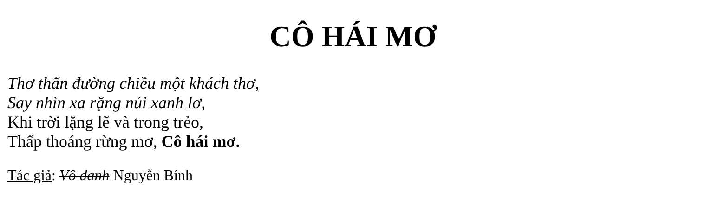

# Bài 1.2.4. Định dạng tổng hợp

Bài tập trong giáo trình *Bài tập Thiết kế Web*, phần 1.2 Định dạng văn bản (trang 20–21, hình 1.7).

## Đề bài

Soạn thảo trang Web có nội dung và định dạng theo mẫu (bài thơ *Cô hái mơ*). Yêu cầu:

- Có nội dung thanh tiêu đề, định dạng đậm, nghiêng, gạch chân, gạch ngang chữ;
- Có phân cách các đoạn, xuống dòng cho mỗi câu thơ, có câu ghi chú;
- Cố định nội dung bài thơ không bị rớt dòng khi độ rộng cửa sổ trình duyệt không đủ (thẻ `pre`).

## Kết quả

Mở tệp **`DinhDangTongHop.html`** bằng trình duyệt.

## Đã làm theo từng yêu cầu

| Yêu cầu | Cách làm |
|---|---|
| Nội dung thanh tiêu đề | `<title>Cô hái mơ</title>` |
| Chữ đậm | `<b>Cô hái mơ.</b>` |
| Chữ nghiêng | `<i>` cho hai câu thơ đầu và chữ "Vô danh" |
| Gạch chân | `<u>Tác giả</u>` |
| Gạch ngang chữ | `<s>Vô danh</s>` |
| Phân cách các đoạn | tiêu đề `<h1>`, bài thơ `<pre>`, dòng tác giả `
` |
| Xuống dòng cho mỗi câu thơ | mỗi câu thơ một dòng trong thẻ `<pre>` (thẻ `pre` giữ nguyên chỗ xuống dòng) |
| Câu ghi chú | các đoạn `<!-- ... -->` trong mã nguồn |
| Không rớt dòng khi cửa sổ hẹp | bài thơ đặt trong thẻ `<pre>` |
| Tiêu đề canh giữa | `<h1 align="center">` (như bài 1.2.2) |

Thẻ `pre` mặc định dùng phông chữ đều nét, nên trang có thêm vài dòng CSS
để đổi sang phông Times New Roman cho giống hình mẫu.

> Bài thơ *Cô hái mơ* là của nhà thơ **Nguyễn Bính**. Vì vậy chữ "Vô danh" trong hình mẫu
> được gạch ngang và tên tác giả được ghi bên cạnh.
